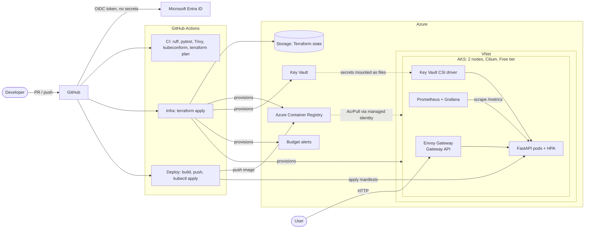

# Production-style AKS Platform on Azure (IaC + CI/CD + Observability)

A small FastAPI service deployed to Azure Kubernetes Service, with everything — network, registry,
cluster, secrets, budget alerts, pipelines, monitoring — defined as code and rebuildable with one command.

> **Constraint-driven design:** built on a free-trial subscription limited to **4 vCPU**, so the whole platform
> is sized to run on 2 × `Standard_D2nls_v6` nodes (2 vCPU / 4 GiB each), with trimmed resource requests,
> upgrade surge disabled, and a cost budget with alerts.

## Architecture



## What is in here

| Area | What I built | Where |
|---|---|---|
| Infrastructure as Code | Terraform modules (network, ACR, AKS, Key Vault, budget), remote state in Azure Storage with locking, bootstrap stack for the state backend | `terraform/` |
| Application | FastAPI service: health/readiness probes, CRUD demo, Prometheus metrics, CPU-burn endpoint for autoscaling demos, 12-factor config | `app/` |
| Container | Multi-stage Dockerfile, non-root user, pinned dependencies | `app/Dockerfile` |
| Kubernetes | Kustomize base + dev/prod overlays: probes, resource limits, HPA, PodDisruptionBudget, topology spread, read-only root FS, dropped capabilities, NetworkPolicies (default-deny), Pod Security labels | `k8s/` |
| Traffic | Kubernetes **Gateway API** via Envoy Gateway (chosen over Ingress-NGINX, which was retired upstream in March 2026) | `k8s/base/gateway.yaml`, `k8s/platform/` |
| Secrets | Azure Key Vault (RBAC) mounted into pods with the Secrets Store CSI driver; app never sees credentials in env vars or Git | `terraform/modules/keyvault`, `k8s/base/secretproviderclass.yaml` |
| CI/CD | GitHub Actions with **OIDC federation to Azure (no stored credentials)**: lint, tests, image scan, manifest validation, `terraform plan` on PRs, `terraform apply` and deploy on merge, approval-gated prod | `.github/workflows/` |
| Second CI system | Equivalent Azure DevOps pipeline (workload identity federation) | `azure-devops/` |
| Observability | kube-prometheus-stack (Helm) tuned for small nodes, ServiceMonitor, alert rules, Grafana dashboard | `monitoring/` |
| Cost control | Resource-group budget with 50/80/100% alerts, no auto-upgrade surge, one-command teardown | `terraform/modules/budget`, `scripts/teardown.sh` |

## Key design decisions

- **OIDC instead of service-principal secrets** — nothing to rotate or leak; each GitHub context (PR, main, environment) maps to its own federated credential.
- **Terraform applied only from CI** — changes are reviewed through a PR plan comment, then applied from `main`; state is locked via blob lease.
- **Gateway API instead of Ingress** — the Ingress-NGINX project was retired in March 2026 and Microsoft's managed NGINX add-on is supported only until November 2026. Envoy Gateway is a light, actively maintained Gateway API implementation whose resources I can cap on a 4 GiB node.
- **Key Vault with RBAC, read-only for pods** — the CSI identity gets `Key Vault Secrets User`; only the pipeline identity can write.
- **Cilium NetworkPolicies, default-deny** — only the gateway, Prometheus and same-namespace pods can reach the app.
- **Deliberately no auto-upgrades** — AKS upgrades add a surge node, which would exceed the 4 vCPU quota.
- **Pod security hardening** — non-root, read-only filesystem, all capabilities dropped, seccomp `RuntimeDefault`.

## Run it yourself

See [`docs/RUNBOOK.md`](docs/RUNBOOK.md) for the exact, ordered steps (about 90 minutes end to end, roughly ₹500/day while running).

```bash
./scripts/00-preflight-and-bootstrap.sh          # quota check, providers, Terraform state backend
./scripts/01-setup-github-oidc.sh OWNER/REPO     # passwordless GitHub -> Azure trust
# then in GitHub Actions: Infrastructure -> Platform add-ons -> Build and deploy
./scripts/load-test.sh start                     # watch the HPA scale the app out
./scripts/teardown.sh                            # destroy everything, stop billing
```

## Demo

_Add after your run:_ architecture screenshot, pipeline run screenshot, Grafana dashboard during load test, `kubectl get hpa -w` output, link to the demo video.

## Known limitations / next steps

- Single environment cluster; `prod` is a second namespace, not a separate cluster.
- No TLS yet (needs a domain; cert-manager + Let's Encrypt is the next step).
- Alertmanager is disabled to save memory, so alerts are visible in Prometheus/Grafana but not routed anywhere.
- Argo CD (GitOps) is planned as a replacement for the `kubectl apply` deploy step.
